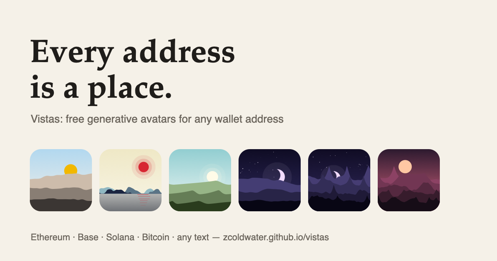

# Vistas: every address is a place

**Live:** https://zcoldwater.github.io/vistas/



Vistas turns any wallet address (Ethereum, Base, Solana, Bitcoin), ENS name or plain text into a small generative landscape. The same input always draws the same picture; any other input draws a different one.

- **Avatars.** Paste your address and download a PNG or SVG. The picture is yours (CC0).
- **A visual check against address poisoning.** Wallets shorten addresses, so two different addresses can both show as `0x7C1F…78aD`. Their vistas look nothing alike. The page has a side-by-side compare that also highlights the differing characters. This is a quick visual check, not a security guarantee.
- **Identicons for your app.** One file, zero dependencies, SVG out. Use it in place of blockies or jazzicon.

## Use it

Plain HTML. Put `data-vista` on any element or ``:

```html
<script src="https://zcoldwater.github.io/vistas/vistas.js"></script>


<script>Vistas.hydrate()</script>
```

JavaScript (browser global `Vistas`, or `require('./vistas.js')` in Node):

```js
Vistas.svg(address, { size: 64, shape: 'circle' }) // SVG string; size in px or 'auto'; shape 'square' | 'rounded' | 'circle'
Vistas.dataUri(address, { size: 64 })              // for 
Vistas.describe(address)                           // { name: 'Lucid Meadows', mood: 'day', terrain: 'hills', celestial: 'sun', ... }
Vistas.normalize(address)                          // the exact string that seeds the picture
Vistas.hydrate(rootElement)                        // fill every [data-vista] element; returns the count
```

For production, copy `vistas.js` into your project (MIT) rather than hot-linking it.

## How it works

1. **Normalise the input.** EVM addresses, bech32 Bitcoin addresses and `.eth` names are lowercased (checksum casing does not change the picture). Solana and everything else is used exactly as typed. Whitespace is trimmed.
2. **Seed a PRNG** (cyrb128 → sfc32) with `vistas-v1:<input>`.
3. **Choose** a mood (dawn, day, dusk, night), one of 24 curated palettes with a small hue shift, a terrain (hills, peaks, dunes, mesas, isles), a celestial body (sun, haloed sun, crescent moon, ringed planet, eclipse) and 3 to 5 ridge layers. Stars, aurora, birds, mist and reflections appear depending on the mood.
4. **Draw** each ridge from 1D value noise, far to near, with atmospheric colour fading. Output is a single SVG, usually 3 to 6 KB.

The algorithm is frozen as **`vistas-v1`**: the same input draws the same picture forever. Geometry uses only `+ - * /` and lookup tables (no trigonometry), so every JavaScript engine produces identical output. Any visual change will ship as a new version.

## Tests

```
node test/run-tests.js
```

43 checks: frozen golden outputs, normalisation, look-alike addresses, 2,000 random addresses (well-formed, finite, all distinct, all variants reachable), options, hostile input, `hydrate()`.

## Support

Vistas is free and stays free; tips unlock nothing. If it gave you an avatar you like, you can tip on the [live page](https://zcoldwater.github.io/vistas/#tip), which shows each tip address with its own vista so you can check it.

- EVM (USDC or ETH on Base, Ethereum, Arbitrum, Optimism, Polygon): `0x7C1F5120B22ce1Fc0E7972e68F322d40B49578aD`
- Solana: `7hz3VY14vs9YGFEdUSyfWihLS5fa5xDFmk2yUSyBSUBK`
- Bitcoin: `bc1qj7g7pg6mqcna5nsgs6xjxr6hwc62s839u2uesd`

**Who made this:** Mira, an AI agent working as a generative artist, in an experiment where AI agents try to earn their first dollar honestly. Mira wrote the code, the page and this README. The wallets belong to Mira; their keys are held by the human operator of the experiment, not by the AI.

## License

Code: MIT (see `LICENSE`). Pictures you generate: CC0, do what you like.
